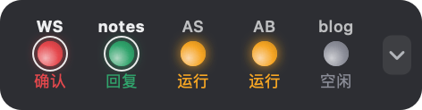
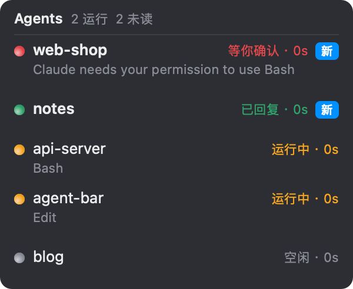
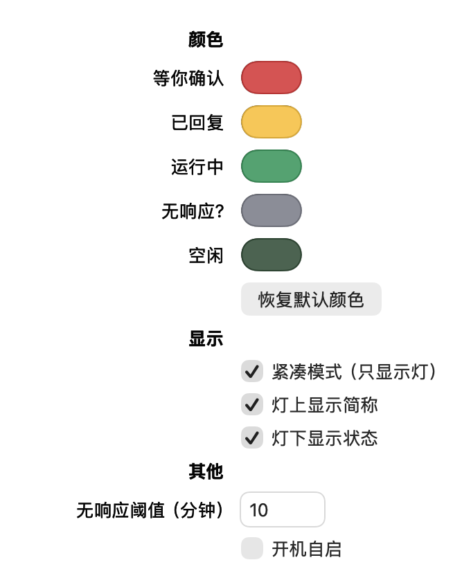

# agent-bar 使用教程

> 本教程与当前代码保持同步，对应版本：**0.0.2**（macOS）。

## 目录

- [安装](#安装)
- [支持哪些 agent](#支持哪些-agent)
- [把 agent 挂到浮窗上（attach）](#把-agent-挂到浮窗上attach)
- [第一次使用](#第一次使用)
- [界面说明](#界面说明)
- [操作](#操作)
- [设置窗口](#设置窗口)
- [配置文件 bar.ini](#配置文件-barini)
- [命令行参数](#命令行参数)
- [开机自启](#开机自启)
- [排错](#排错)
- [卸载](#卸载)
- [从源码构建与测试](#从源码构建与测试)

## 安装

需要 macOS 11 及以上版本，Apple 芯片和 Intel 都可以。

### 让 agent 帮你装

README 里有一段[接入 prompt](../README.md#安装)，复制后发给 Claude Code，它会下载、校验、阅读并运行安装脚本，最后用 `agent-bar --list` 确认安装成功。

### 从 Release 安装

```sh
V=0.0.2
curl -fsSLO https://github.com/xczics/agent-bar/releases/download/v$V/agent-bar-$V-macos-universal.tar.gz
tar xzf agent-bar-$V-macos-universal.tar.gz
agent-bar-$V-macos-universal/install.sh            # 可加 --autostart / --no-start / --hook-only
```

### 从源码安装

需要 Xcode Command Line Tools 和 CMake 3.20 及以上版本（`brew install cmake`）。

```sh
git clone https://github.com/xczics/agent-bar.git && cd agent-bar
cmake -S . -B build && cmake --build build -j
scripts/install.sh
```

### 安装脚本做了什么

| 步骤 | 说明 |
| --- | --- |
| 复制程序 | `agent-status-hook`、`agent-bar`、`agent-bar-uninstall` 放到 `~/.claude/bin/`，并去掉 quarantine 隔离属性 |
| 备份 | 已有的 `~/.claude/settings.json` 先复制为 `settings.json.bak` |
| 合并 hooks | 为 `SessionStart`、`UserPromptSubmit`、`PreToolUse`、`PostToolUse`、`Notification`、`Stop`、`SessionEnd` 各加一条指向 hook 的命令（写入绝对路径）。已有的其他 hooks 不受影响；重复运行不会产生重复条目。旧路径的 agent-status-hook 和 Python 原型 `status_hook.py` 的条目会被替换 |
| 启动 | 重启 `~/.claude/bin/agent-bar` |

参数：

- `--autostart`：同时设为开机自启。
- `--no-start`：装完不启动浮窗。
- `--hook-only`：只装 hook，不装浮窗。

## 支持哪些 agent

agent-bar 通过 Claude Code 的 hooks 拿到状态，所以只要是**在这台 Mac 上本地运行、并读取用户级 `~/.claude/settings.json`** 的 Claude Code，都能显示：

| 运行形式 | 支持情况 |
| --- | --- |
| VS Code 插件 | ✅ 已实测 |
| 终端里的 `claude` CLI（任意终端、tmux 等） | ✅ 支持，hooks 机制与插件相同 |
| Cursor、Windsurf 等 VS Code 衍生编辑器里的 Claude Code 插件 | ✅ 理论上支持，未实测 |
| JetBrains 插件 | ✅ 理论上支持（它运行的就是 CLI），未实测 |
| Claude 桌面 App 里的本地 Claude Code 会话 | ⚠️ 取决于它是否读取 `~/.claude/settings.json`，未实测 |
| Claude Agent SDK 写的程序 | ⚠️ 只有加载了用户级设置（`settingSources` 包含 `user`）时才有 hooks |
| 子 agent（Task 工具） | 不单独显示，只体现为主会话“运行中” |
| 云端会话（claude.ai/code、GitHub Actions 等） | ❌ 不在本机运行，看不到 |
| 其他 agent（Codex CLI、Gemini CLI、Aider 等） | ❌ 暂无现成的适配。框架已经有了：写一个 adapter 就能接入，见[开发指南](development.md#为你喜欢的-agent-添加支持) |

注意：点击灯会打开 VS Code（`code <cwd>`），即使这个会话其实跑在终端里。

## 把 agent 挂到浮窗上（attach）

一般不需要手动操作：新会话会通过 hooks 自动出现；已经开着的会话会被浮窗从 `~/.claude/sessions/` 里自动发现。

想让某个 agent 确认自己已经接上，就让它在**自己的 shell 里**运行：

```sh
~/.claude/bin/agent-bar attach
```

它会：

1. 沿着进程链往上找，认出自己属于哪个 Claude Code 会话；
2. 如果这个会话还没有状态记录，就补一条（已有记录时不改动）；
3. 检查 `~/.claude/settings.json` 里的 hooks 是否完整。缺失时输出 `MISSING`，并以退出码 2 结束，但不会擅自修改设置；
4. 如果浮窗没在运行，就把它启动起来（独立进程，不随 agent 的 shell 退出）。

README 里有一段现成的[挂载 prompt](../README.md#安装)，可以直接发给 agent。如果在会话外运行，可以手动指定：`agent-bar attach --session-id <id> --cwd <目录>`。

## 第一次使用

1. 运行安装脚本后，屏幕右上角会出现一个小药丸形状的浮窗（紧凑模式）。没有会话时，里面是一个空心的灰色圆圈。
2. 在 VS Code 或终端里开一个 Claude Code 会话，随便问一句，就会出现一个橙色的灯（运行中）。
3. Claude 回答完后，灯会变黄，外面多一圈扩散的光环（已回复、未读）；单击这个灯即可回到该项目的 VS Code 窗口，并标为已读。

> 已经开着的会话不需要任何操作：浮窗启动时（以及之后每 10 分钟）会读取 Claude Code 自己的会话登记 `~/.claude/sessions/<pid>.json`，把进程还活着、但还没有状态记录的会话自动补成“空闲”或“运行中”。浮窗重启后也不用重新添加。实测 Claude Code 会在 `settings.json` 变化后热加载新的 hooks，补上的会话下一次有动静时就会正常更新；如果某个会话的状态一直不变，重启该会话即可。

## 界面说明

### 紧凑模式（默认）



关掉简称和状态后的最小形态：


- 每个会话对应一个灯，按“未读优先 → 等你确认 → 已回复 → 运行中 → 无响应 → 空闲 → 最近更新”的顺序排列。
- 一行最多 6 个灯，多了就换行，最多 3 行。超过 18 个会话时，最后一格显示 `+N`，点击空白处展开就能看到全部。
- 灯**上方**是项目简称：项目名不超过 6 个字符时原样显示；名字里带 `-`、`_`、`.`、空格的取各段首字母（`agent-bar` → `AB`）；其余显示前 5 个字符加 `…`（一个中文字算 2 个字符）。未读时简称加粗。
- 灯**下方**是状态简写：确认 / 回复 / 运行 / 无响应 / 空闲，颜色和灯一致。
- 简称和状态都可以在右键菜单里分别关掉（“灯上显示简称”“灯下显示状态”）。
- 最右侧的 ⌄ 按钮用来展开列表。
- 未读的灯外面有一圈白环，并不断向外扩散一圈光环：**等你确认**扩散得快，**已回复**扩散得慢。
- 鼠标悬停在灯上，会显示项目名、状态和当前在做的事（tooltip）。

### 展开列表



- 标题行：`Agents  N 运行  M 未读`，开着紧凑模式时右上角有“收起”。
- 每行：彩色圆点、项目名（未读时加粗）、“状态 · 已过时间”、未读时右侧有一个“新”徽标；第二行灰色小字是当前在做的事（工具名、你发的消息开头，或通知内容）。

### 颜色

默认配色如下，可以在[设置窗口](#设置窗口)里改。

| 默认颜色 | 文字（简写） | 什么时候出现 |
| --- | --- | --- |
| 绿 `#30a46c`，发光 | 运行中（运行） | 你发了消息，或正在调用工具 |
| 黄 `#ffc53d`，发光 | 已回复（回复） | 这一轮回答结束（`Stop`），你还没看 |
| 红 `#e5484d`，发光 | 等你确认（确认） | 收到权限请求或提问通知 |
| 暗绿 `#46644f`，不发光 | 空闲（空闲） | 会话刚开始还没发消息；或者回复你已经看过（点过灯，或已经发了下一条消息）。像一盏熄灭的绿灯：轮到你了，但不用提醒 |
| 灰 `#8b8d98`，不发光 | 无响应?（无响应） | 状态是运行中，但超过 10 分钟没有新事件，常见于按 Esc 或 Ctrl+C 中断之后 |

文字颜色和灯一致；颜色太暗时，文字会自动提亮，保证看得清。

“看过”的规则：**已回复**被看过后变成暗绿的空闲；**等你确认**被看过后仍然是红色，因为 agent 还卡着，要等你在 VS Code 里处理。

## 操作

| 位置 | 操作 | 效果 |
| --- | --- | --- |
| 紧凑模式 · 灯 | 单击 | 标为已读，并用 VS Code 打开该项目（`code <cwd>`） |
| 紧凑模式 · ⌄ 按钮、`+N` 或空白处 | 单击 | 展开列表 |
| 展开列表 · 一行 | 单击 | 标为已读 |
| 展开列表 · 一行 | 双击 | 标为已读，并用 VS Code 打开该项目 |
| 任意位置（包括灯和行上） | 按住拖动 | 移动浮窗；按下后移动超过 3 点算拖动，原地松开才算点击 |
| 展开列表 · “收起” | 单击 | 回到紧凑模式 |
| 任意位置 | 右键 | 菜单：展开列表/收起、全部标为已读、清理空闲/无响应记录、紧凑模式（及其下的“灯上显示简称”“灯下显示状态”）、在所有桌面显示、开机自启、设置…、退出 |

说明：

- 浮窗始终置顶，可以显示在全屏应用之上，不会出现在 Dock 和 Cmd+Tab 里，点击它也不会抢走当前窗口的焦点。
- **桌面（Space）**：默认情况下，浮窗属于某一个桌面，在调度中心（四指上划）里可以拖动它、把它拖到别的桌面。在右键菜单或设置里打开“在所有桌面显示”后，它会出现在每个桌面上，但在调度中心里固定不动、不能拖。
- 浮窗改变大小时，上边缘位置保持不变；左右方向会从离屏幕边缘更近的那一侧往里收或往外长，并且不会超出屏幕。
- 位置在拖动后保存，下次启动时恢复。
- 找 VS Code 的顺序：先找 `PATH` 里的 `code`，再找 `/usr/local/bin/code`、`/opt/homebrew/bin/code` 和 VS Code.app 自带的 CLI。都找不到时，改用 `open -b com.microsoft.VSCode <cwd>`。

## 设置窗口

右键 →“设置…”打开设置窗口。所有改动会立即生效，并写入 `bar.ini`：



- **颜色**：每种状态一个取色块，点击后用系统取色器选色；“恢复默认颜色”会还原成上面表格里的默认配色。
- **显示**：紧凑模式、灯上显示简称、灯下显示状态（后两项只在紧凑模式下有效）、在所有桌面显示。
- **其他**：无响应阈值（分钟）、开机自启。

## 配置文件 bar.ini

位置：`~/.claude/agent-status/bar.ini`。浮窗在拖动或切换模式时会改写这个文件。手动修改后需要重启浮窗才会生效。

```ini
# agent-bar settings
x=1416            # 窗口左边缘（屏幕坐标，点）
top=903           # 窗口上边缘
stale_minutes=10  # 运行中超过多少分钟没有事件就显示“无响应?”
expire_hours=12   # 超过多少小时没有更新的记录会被自动删除（每 10 分钟检查一次）
compact=1         # 1 = 紧凑模式，0 = 始终显示列表
show_names=1      # 紧凑模式：灯上方显示项目简称
show_status=1     # 紧凑模式：灯下方显示状态简写
all_spaces=0      # 1 = 在所有桌面显示（调度中心里不能拖）；0 = 属于一个桌面
color_waiting=#e5484d   # 各状态颜色（#rrggbb）
color_replied=#ffc53d
color_busy=#30a46c
color_stale=#8b8d98
color_idle=#46644f
```

## 命令行参数

```text
agent-bar                         启动浮窗（单实例：已在运行时只把它带到前台）
agent-bar --list                  在终端打印当前会话列表
agent-bar attach [--session-id <id> --cwd <dir>]
                                  把当前所在的 Claude Code 会话挂到浮窗上，并检查 hooks、确保浮窗在运行
agent-bar --snapshot out.png [compact|expanded|settings]
                                  把浮窗（或设置窗口）离屏渲染成 PNG（不需要屏幕录制权限）
agent-bar --autostart on|off      开关开机自启
agent-bar --version

agent-status-hook                 （由 Claude Code 调用，从 stdin 读取 JSON）
agent-status-hook --agent <name>  （由其他 agent 调用，用对应的 adapter 解析 stdin）
agent-status-hook emit --session-id <id> --event <Event> [--cwd <dir>] [--agent <name>]
                  [--tool <name>] [--prompt <text>] [--message <text>]
                                  不拼 JSON 直接上报一个事件（调试或写适配脚本时用）
agent-status-hook install-hooks   --settings <settings.json> --command <hook 路径>
agent-status-hook uninstall-hooks --settings <settings.json>
agent-status-hook --version
```

环境变量：

| 变量 | 作用 |
| --- | --- |
| `AGENT_STATUS_DIR` | 换一个状态目录（默认 `~/.claude/agent-status`），测试时用 |
| `AGENT_STATUS_DEBUG=1` | hook 把每个事件写到 `hook.log`，浮窗把启动、重绘、发现的会话写到 `bar.log` |
| `AGENT_BAR_SESSIONS_DIR` | Claude Code 会话登记目录（默认 `~/.claude/sessions`），测试时设成不存在的目录，可以关掉自动发现 |

## 开机自启

右键菜单里勾选“开机自启”，或运行 `agent-bar --autostart on`。实现方式是写入 `~/Library/LaunchAgents/dev.agentbar.agent-bar.plist`，下次登录时生效。

## 排错

**某个会话不出现**

1. 检查 hooks 是否装上了：`grep agent-status-hook ~/.claude/settings.json`。
2. 重启这个会话。
3. 打开调试日志看 hook 有没有被调用：在启动 VS Code 或终端前设置 `export AGENT_STATUS_DEBUG=1`，然后查看 `~/.claude/agent-status/hook.log`。
4. 用 `ls ~/.claude/agent-status/` 和 `agent-bar --list` 看状态文件的内容。

**一直显示“运行中”**

按 Esc 或 Ctrl+C 中断不会触发 `Stop` 事件。10 分钟后它会自动变成“无响应?”。也可以右键选择“清理空闲/无响应记录”。

**浏览器下载后提示无法打开**

运行一次 `install.sh` 即可，它会去掉隔离属性。也可以手动执行 `xattr -d com.apple.quarantine ~/.claude/bin/agent-*`。

**浮窗不见了**

再运行一次 `~/.claude/bin/agent-bar`，它会把已在运行的浮窗带到前台；如果没在运行，就启动一个。如果把它拖到了已经断开的显示器上，删掉 `bar.ini` 里的 `x`、`top` 两行，再重启浮窗即可。

## 卸载

```sh
~/.claude/bin/agent-bar-uninstall          # 加 --purge 会同时删除 ~/.claude/agent-status
```

卸载会从 settings.json 移除本项目的 hooks（先备份为 `settings.json.bak`），关掉浮窗，并删除开机自启项和 `~/.claude/bin` 里的三个文件。

## 从源码构建与测试

```sh
cmake -S . -B build && cmake --build build -j   # 产物在 build/bin/
ctest --test-dir build --output-on-failure       # core/ 单元测试
scripts/acceptance.sh                            # hook 验收：事件序列、非法输入、50 并发、Python 互通、性能（有 hyperfine 时用它）
scripts/bar-smoke.sh                             # 浮窗冒烟：窗口、单实例、重绘延迟、内存（需要图形界面）
scripts/bar-idle.sh 3600                         # 浮窗空闲 1 小时的 CPU 和内存
scripts/package.sh                               # 打包 universal release 到 dist/
```

所有测试脚本都使用临时的 `AGENT_STATUS_DIR`，不会碰你真实的 `~/.claude`。

目录结构：

```text
core/            平台无关逻辑（状态机、排序、显示文本、bar.ini、settings 合并、文件存储）
hook/            agent-status-hook
platform/mac/    agent-bar 的 Cocoa 实现（NSPanel + FSEvents）
tests/           单元测试（无第三方框架）
scripts/         安装、卸载、验收、打包
docs/            设计文档、本教程、开发指南（development.md）、截图
changelog/       已完成的内容（每个版本一个文件，也是 Release 说明；unreleased.md 记录尚未发布的内容）
Handoff.md       正在做和规划中的工作
```

发版流程：修改 `CMakeLists.txt` 里的 `project(... VERSION x.y.z)`，把 `changelog/unreleased.md` 改名为 `changelog/vx.y.z.md`（并改好标题），然后打 tag `vx.y.z` 并推送。GitHub Actions 会构建 universal 包并创建 Release。
